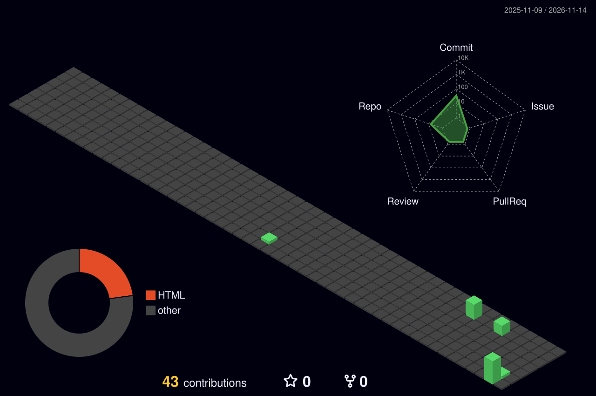

## The city I built this year

Every building is a day; taller means more contributions.

## Population

 

## Landmarks

<table>
  <tr>
    <td width="50%">
      
    </td>
    <td width="50%">
      
    </td>
  </tr>
  <tr>
    <td width="50%">
      
    </td>
    <td width="50%">
      
    </td>
  </tr>
</table>

## Visit

  

Umi Fatin binti Mohammad Affandi · Contribution city generated with <a href="https://github.com/yoshi389111/github-profile-3d-contrib">github-profile-3d-contrib</a> (MIT)

